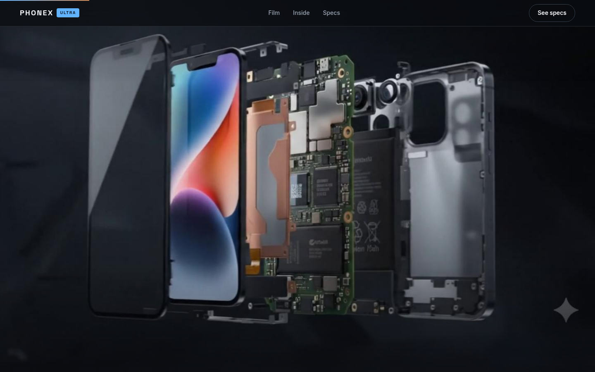
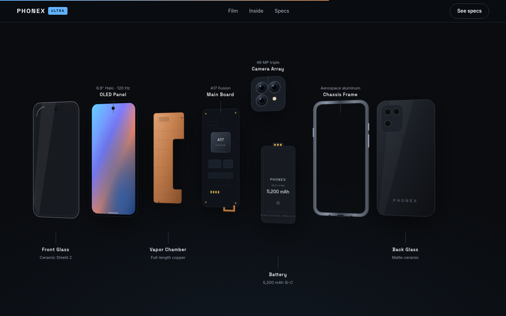
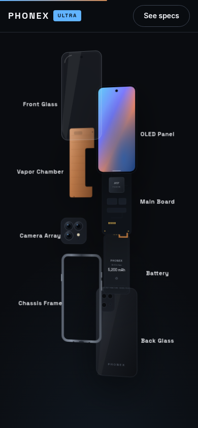

# 3D Break-Apart (Exploded View) Effect — complete guide

A scroll-driven product page where a phone tumbles, **breaks apart into its
internal layers**, and reassembles as you scroll — the "PHONEX ULTRA" demo.
This repo is the complete, self-contained recipe: the original AI prompt, the
source film, every asset, the working page, the verification harness, and a
single-file artifact you can open or share anywhere. **No backend, no keys, no
server config — nothing here to leak.**


| The film breaks the phone apart… | …then vectors fan it out, labeled |
|---|---|
|  |  |

| What | Where |
|---|---|
| The original AI video prompt + generation settings | [`PROMPT.md`](PROMPT.md) |
| The AI-generated source film the frames came from | [`media/film.mp4`](media/film.mp4) |
| The working site (serve the folder) | [`site/`](site/) |
| Single-file version — every asset inlined, works from a double-click | [`artifact/phonex-ultra-exploded-effect.html`](artifact/phonex-ultra-exploded-effect.html) |
| Script that builds the single file from `site/` | [`artifact/build.mjs`](artifact/build.mjs) |
| Film → frame-sequence extraction script | [`scripts/extract-frames.sh`](scripts/extract-frames.sh) |
| Playwright audit: screenshots · console · 404s · overflow · reduced-motion | [`scripts/verify.mjs`](scripts/verify.mjs) |
| Fill-in-the-blanks prompt to have an AI build one for *your* product | [`docs/PROMPT-TEMPLATE.md`](docs/PROMPT-TEMPLATE.md) |

## Run it

```bash
npm run serve            # = python3 -m http.server 4173 -d site
# open http://localhost:4173
```

(Or just double-click `artifact/phonex-ultra-exploded-effect.html` — the
single-file build needs no server at all.)

> Serving over HTTP matters for `site/`: the film preloads 120 JPEG frames and
> some browsers throttle `Image()` loads from `file://`.

## How the effect is made, step by step

**Step 1 — one product photo.** A single clean product shot on a dark/neutral
background. Everything downstream is derived from it.

**Step 2 — generate the exploded-view film.** Send the photo to an
image-to-video model (Veo 3.1-class) as the clip's **first frame**, with the
prompt in [`PROMPT.md`](PROMPT.md): 10 seconds, 720p, 16:9, no audio. The model
returns a continuous shot of the product tumbling, separating into layers,
holding, and reassembling. This repo's take is committed at
[`media/film.mp4`](media/film.mp4).

**Step 3 — explode the film into frames.**

```bash
./scripts/extract-frames.sh media/film.mp4
```

extracts ≤120 evenly spaced 1280px-wide JPEGs (the exact ffmpeg reasoning is
in `PROMPT.md` §3) into `site/assets/frames/frame_000.jpg … frame_119.jpg`.
Frame 0 doubles as the poster image.

**Step 4 — the scroll page scrubs the frames.** No `<video>` is ever played.
The two break-apart techniques are stacked back to back, and knowing when to
use which is most of the craft:

| | S1 · The film | S2 · The vector teardown |
|---|---|---|
| What moves | 120 JPEG frames drawn to a `<canvas>` | 8 inline SVG elements |
| Where the 3D comes from | pre-rendered — *real* lighting, motion blur, reflections | CSS 3D transforms (`rotationY`, `perspective`) |
| Scroll's job | pick which frame to draw | pick each layer's position on a timeline |
| Cost | ~5.3 MB of JPEGs | a few KB of SVG |
| Best for | cinematic hero moments | labeled, restylable, accessible diagrams |

### S1 · Film — the scroll-scrubbed image sequence

The classic Apple-launch-page technique, in `site/main.js`. A pinned section
(450% of the viewport height on desktop, 300% on mobile) maps scroll progress
linearly to a frame index; every scroll event just draws a different JPEG:

```js
film.to(filmState, {
  frame: FRAME_COUNT - 1,
  ease: 'none',                     // scroll owns the pacing — never ease a scrub
  onUpdate: () => drawFrame(filmState.frame),
}, 0);
```

The details that make it feel professional (all commented in the source):

- **Why not `<video currentTime>`?** Seeking video is keyframe-quantized and
  janky under fast scrubbing; iOS Safari fights you even after re-encoding
  with all-keyframes. Individual JPEGs decode independently and never stutter.
- **Two-pass preload** — every 6th frame first, then the gaps — so early
  scrubbing always has coverage; `nearestLoaded()` substitutes the closest
  decoded frame until the exact one arrives. A thin loader bar tracks progress.
- **Cover-fit draw**: `drawFrame()` reimplements `object-fit: cover` in canvas
  math, so the 16:9 film crops correctly at any viewport shape.
- **DPR cap**: the canvas backing store never exceeds the frames' native
  1280 px — a retina-sized store would upscale JPEG pixels and slow every draw.
- **Copy beats ride the same timeline** — each caption fades in/out at
  fractions (`0.24 → 0.37`, `0.45 → 0.58`, …) matched to story moments in the
  footage: tumble → screen → *explosion* → chip → reassembly. Opacity only, so
  the text never leaves the accessibility tree.
- **A poster `` sits under the canvas**, preloaded from `<head>` — first
  paint never waits for JavaScript.

### S2 · Teardown — the layered vector exploded view

The film's exploded moment rebuilt as *live DOM* so it can be labeled,
restyled, and read by screen readers. Eight hand-drawn SVG layers (front
glass, OLED, vapor chamber, board, camera, battery, frame, back glass) start
stacked as one angled phone, then fan out under a pinned scrubbed timeline —
horizontal spread on desktop, cascading fan on mobile:

```js
const SLOTS = {
  desktop: { glass: { x: -39.5, y: 0 }, oled: { x: -28, y: 0 }, /* … */ },
  mobile:  { glass: { x: -9, y: -28 }, oled: { x: 9, y: -20 }, /* … */ },
};
layers.forEach((el, i) => {
  const slot = SLOTS[key][el.dataset.layer];
  tl.to(el, { x: () => vw(slot.x), y: () => vh(slot.y), duration: 0.5 },
        0.06 + i * 0.03);          // the stagger IS the "break apart" ripple
});
```

Worth stealing:

- **DOM order is paint order.** Back glass first in the markup, front glass
  last — no z-index management at all.
- **Slots are data, not choreography.** Retargeting the layout (or adding a
  breakpoint) means editing a table.
- **`gsap.matchMedia()` with contiguous queries** (`900.1px` / `900.09px`) — a
  plain `900px`/`901px` pair leaves a dead zone at fractional zoom widths
  where neither scene would build.
- **Labels chase their layers**: each label's reveal is scheduled at
  `layerStart + travelTime`, so it appears exactly as its component seats.
- **A non-scrubbed idle float** on the SVG child (not the positioned wrapper)
  keeps the spread alive after the scrub settles — two animation systems on
  one element without fighting, because they own different targets.



### S3–S5 and the supporting cast

Static blueprint / features / specs sections with one-shot scroll reveals.
Smooth scrolling is Lenis, wired the canonical way (`lenis.on('scroll',
ScrollTrigger.update)`, driven from `gsap.ticker`, `lagSmoothing(0)`); the
scroll-progress hairline is a `gsap.quickSetter` — the cheapest possible
per-scroll write.

### Resilience (the part everyone skips)

- **No JavaScript / CDN failure** → the `html.no-js` CSS lays the whole page
  out statically: poster instead of canvas, all copy in flow.
- **`prefers-reduced-motion`** → no pin, no scrub, no smooth scroll; every
  beat and label readable. `scripts/verify.mjs` asserts this with an emulated
  pass.
- **Keyboard** → skip link past the animated intro, visible focus rings, and
  anchor navigation that moves focus to its target section.
- Every ScrollTrigger sets `invalidateOnRefresh: true`; one global
  `ScrollTrigger.refresh()` re-measures after `window.load`.

**Step 5 — build the single-file artifact.**

```bash
node artifact/build.mjs
```

reads `site/`, inlines the fonts, the 120 frames, the stills and the vendor
libraries as data URIs, and writes `artifact/phonex-ultra-exploded-effect.html`
(~7.7 MB) — a complete page with zero network dependencies.

## Verify like a pro

```bash
npm run serve                        # terminal 1
npm install && npm run verify        # terminal 2 (installs Playwright)
# in a sandbox with a preinstalled browser:
CHROMIUM_PATH=/opt/pw-browsers/chromium npm run verify
```

The audit screenshots desktop 1440×900 at 0/15/30/45/60/75/90 % scroll and
mobile 390×844 at three positions, then fails the run on: any console error,
any 4xx/5xx or failed request, any horizontal overflow, or reduced-motion
hiding copy. Screenshots land in `screenshots/` — **look at every one**;
pixels catch what assertions can't.

## Assets inventory

| Asset | Count / size | Origin |
|---|---|---|
| `media/film.mp4` | 10 s, 1280×720, ~2.8 MB | AI-generated (image-to-video, see `PROMPT.md`) |
| `site/assets/frames/frame_000–119.jpg` | 120 frames, ~5.3 MB, 1280×720 | extracted from the film |
| `site/assets/img/*.jpg` | 5 stills, ~280 KB (`phone-assembled.jpg` is a spare, unused by the page) | frames/crops of the same film |
| `site/assets/fonts/*.woff2` | Inter 400/500/600 · Space Grotesk 500/600/700 (latin subset) | self-hosted, SIL OFL licensed |
| `site/assets/vendor/` | GSAP 3.13.0 + ScrollTrigger 3.13.0 (GreenSock standard license) · Lenis 1.3.8 (MIT) | vendored, pinned |
| `site/index.html` / `styles.css` / `main.js` | ~51 KB | the page itself — markup, design system, animation |

## Reusing this for your own product

1. Generate your own film from your product photo (`PROMPT.md` has the
   verbatim prompt — swap `{subject}`; sneaker, watch, espresso machine…).
2. Replace the frames + stills: `./scripts/extract-frames.sh your-film.mp4`.
   Update `FRAME_COUNT` in `site/main.js` if you extracted fewer than 120.
3. Edit the copy in `site/index.html` (beats, blueprint list, specs) and, if
   you like, redraw the eight teardown SVG layers for your product — each is a
   small inline SVG (300×640 viewBox; the square camera module is 220×220),
   flat-shaded with 2–3 gradients.
4. Re-time the film's copy beats to *your* footage: scrub slowly, note the
   fractions where story moments happen, and move the `0.24 / 0.45 / 0.65 /
   0.88` positions in `site/main.js` to match.
5. `npm run verify`, look at every screenshot, then
   `node artifact/build.mjs` → share the single file.

Or make an AI do the whole loop: [`docs/PROMPT-TEMPLATE.md`](docs/PROMPT-TEMPLATE.md)
is a fill-in-the-blanks, phased version of the prompt that produced this repo —
hand it to Claude Code (or similar) together with your film and it walks the
same asset → design → build → verify process.

**If you change the teardown layers**, keep the three-way contract intact:
each `.layer` div's `data-layer` name must match a key in `SLOTS`
(`site/main.js`) *and* a label's `data-for` attribute in `index.html`, and the
layers' DOM order is their paint order (back glass first, front glass last) as
well as their fan-out order. Adding, removing, or renaming a layer means
touching all three places.

**If you rename assets**: `artifact/build.mjs` auto-detects how many
`frame_NNN.jpg` files exist, but inlines the stills and fonts by name — a
renamed or added still/font needs a matching edit to the lists at the top of
`build.mjs` (the build fails loudly, never silently, if a reference is left
un-inlined).

## Engineering rules this repo follows (steal these)

1. Three files + assets. No build step, no frameworks.
2. Animate **only** `transform`, `opacity`, `clip-path`, `filter` — never
   layout properties. (The canvas is the one deliberate exception: it repaints
   pixels, which is the entire point of the technique.)
3. Every ScrollTrigger: `invalidateOnRefresh: true`; one global refresh on
   `window.load`.
4. Explicit `width`/`height` on images; `loading="lazy"` below the fold;
   `<link rel="preload">` for the poster and the display font.
5. `prefers-reduced-motion` gets a complete, readable, pin-free page — via
   CSS alone, so it holds even if JS never runs.
6. ≤ 900 px: shorter pins, vertical teardown fan, no horizontal scroll ever.
7. Semantic landmarks, real alt text, visible focus, ≥ 4.5:1 body contrast.
8. Scrub timelines use `ease: 'none'` — scroll position owns the pacing.

## Project skills (Claude Code)

`.claude/skills/` holds project skills that Claude Code picks up
automatically when working in this repo — ask Claude to "deploy the site"
or "add payments" and it follows these playbooks instead of improvising:

| Skill | What it does |
|---|---|
| [`deploy-hostinger`](.claude/skills/deploy-hostinger/SKILL.md) | Ships `site/` to Hostinger: hPanel Git auto-deploy via a `hostinger-deploy` subtree branch (`scripts/make-deploy-branch.sh`), or an FTPS mirror (`scripts/deploy-ftp.sh`, env-var credentials, `--dry-run`). Includes cache-header `.htaccess` and a post-deploy validation checklist that reuses `scripts/verify.mjs` against the live URL. |
| [`razorpay-setup`](.claude/skills/razorpay-setup/SKILL.md) | Adds Razorpay payments: the no-backend Payment Button (drop-in section snippet styled for this page), Payment Links, or the full Standard Checkout server flow (orders, HMAC signature verification, webhooks) — with test-mode-first steps and hard rules on which credentials may ever appear in client code. |

Both skills are documentation-plus-tooling: no credentials live in the
repo (`.env.deploy` is gitignored; Razorpay secrets stay in server env
vars), and each ends with a validation checklist rather than a hopeful
"done".

## Disclaimer

The PHONEX ULTRA is not a real product; all product footage is AI-generated.
Not affiliated with any phone maker. This is a practice project for learning
scroll-driven animation — copy anything in it.
